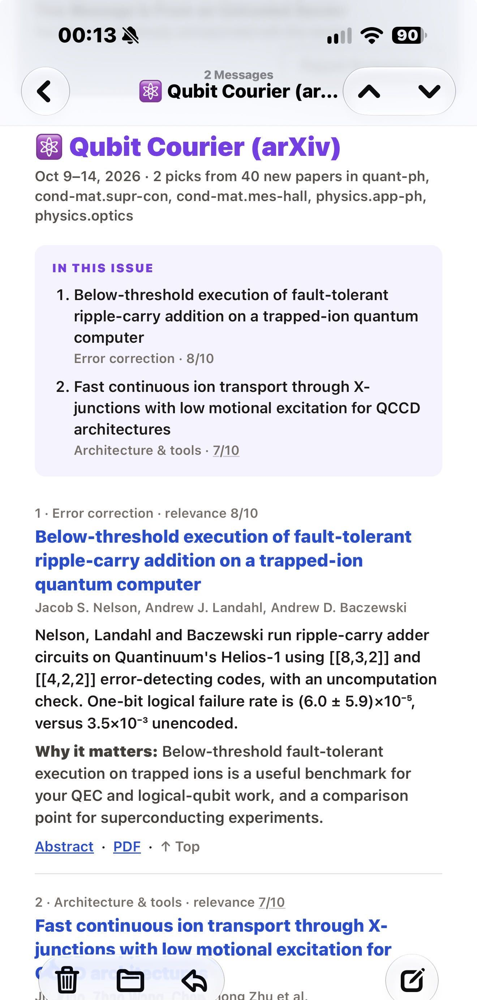
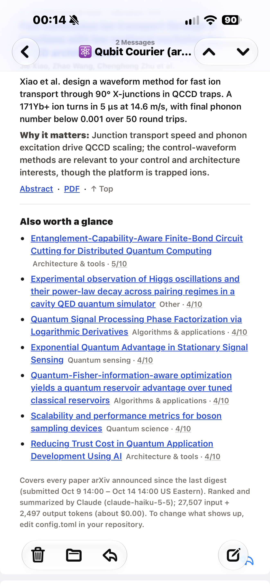

# arXiv-digest

**Your own arXiv feed, delivered to your inbox.**

Describe your research in plain English. Every day, every few days or every week, you get an email with the new papers that matter to *you*, each with a short summary and a line on why it's relevant. It runs on GitHub for free, and Claude does the reading for well under a dollar a week.

<p align="center">
  
  &nbsp;&nbsp;
  
</p>

## Features

- 📝 **Plain-English interests.** You don't need a Zotero library or keyword lists. Write a paragraph about your research, and Claude scores every new paper from 0 to 10 against it.
- 📱 **Built for your phone.** Every title comes first, so you can scan the list in seconds. Then come short write-ups: what the authors did and why it matters to you. In most mail apps, tapping a title jumps to its write-up.
- 🗓️ **On your schedule.** Daily, every 3 days, weekly, or any interval you like. The number of papers scales with the time covered.
- 🎯 **Fresh and complete.** The digest follows arXiv's announcement schedule, so each one has exactly what arXiv announced since the last. Nothing is skipped and nothing is repeated.
- 🛟 **Survives arXiv's rate limits.** arXiv sometimes blocks GitHub's servers for a while. The digest waits it out, retries every 4 hours, and rolls any missed papers into the next email.
- ⭐ **Watch list.** Papers from authors or keywords you choose go to the top of the list, whatever their score.
- 💸 **Cheap, and nothing to maintain.** GitHub Actions is free at this volume. Claude Haiku costs well under $1 a week, and there's nothing to install.

## How it works

```
 arXiv  ──►  digest.py  ──►  Claude Haiku  ──►  your inbox
            (GitHub Actions)  score 0–10,
                              summarize the best
```

1. Every day, GitHub runs the script on its own servers, so your computer can be off.
2. If a digest is due, the script fetches every new paper in your arXiv categories since the last digest.
3. Claude scores each title and abstract against your interests, then writes short summaries of the top-scoring papers.
4. The digest is emailed to you through Gmail.

---

## Set up your own (about 15 minutes)

**You'll need:**

| | Notes |
|---|---|
| A **GitHub** account | The free plan is enough. |
| A **Claude API key** | From [platform.claude.com](https://platform.claude.com). It's billed separately from Claude subscriptions; $5 of credit lasts months. |
| A **Gmail** account to send from | Use a personal one, because school and work accounts often block app passwords. The digest can be *delivered* to any address. |

### 1. Make your copy

Click **Use this template → Create a new repository** at the top of this page. Give it a name, choose **Private**, and click **Create repository**.

> Private is recommended. Your copy holds your research interests and keeps copies of your digests. It's still free.

### 2. Describe your research

In your new repository, open **`config.toml`** and click the ✏️ pencil to edit it. The top three sections are the ones that matter:

- **`[feed]`**: the bot's name, how often you get a digest, how many papers per day it covers, and how long each write-up is.
- **`[arxiv]`**: which [arXiv categories](https://arxiv.org/category_taxonomy) to watch.
- **`[interests]`**: your research description. The file has a detailed **example** for quantum hardware; replace it with your own. Grouping topics into tiers with score ranges, as the example does, makes the scores far more predictable.

> 💡 **Tip:** paste a few of your own abstracts into Claude and ask for a research-interest description in the same format as the example.

Click **Commit changes** when you're done.

### 3. Get a Claude API key

<details>
<summary>Show steps</summary>

1. Sign in at [platform.claude.com](https://platform.claude.com).
2. Under **Billing**, add a small amount of credit.
3. Open **API keys**, click **Create key**, and copy the key (it starts with `sk-ant-`). It's only shown once.

</details>

### 4. Make a Gmail app password

<details>
<summary>Show steps</summary>

1. In the Gmail account you'll send from, turn on **2-Step Verification** at [myaccount.google.com/security](https://myaccount.google.com/security).
2. Go to [myaccount.google.com/apppasswords](https://myaccount.google.com/apppasswords), name the password `arxiv digest`, and click **Create**.
3. Copy the 16-character password. It's only shown once, and the spaces don't matter.

</details>

### 5. Add four secrets

In your repository, go to **Settings → Secrets and variables → Actions → New repository secret**:

| Name | Value |
|---|---|
| `ANTHROPIC_API_KEY` | Your Claude API key |
| `GMAIL_ADDRESS` | The Gmail address you're sending from |
| `GMAIL_APP_PASSWORD` | The app password |
| `DIGEST_TO` | *Optional.* Where to deliver the digest, e.g. your work address. Separate several with commas. If you leave it out, it goes to `GMAIL_ADDRESS`. |

Secrets are encrypted. They never appear in your code and are hidden in the logs.

### 6. Send a test digest

Open the **Actions** tab, then **arXiv digest → Run workflow**. Type `40` in the "Only score this many papers" box and click **Run workflow**. Within a few minutes you'll get a small digest, which costs a fraction of a cent.

**That's it.** From now on digests arrive on your schedule. If the first one lands in spam, mark it "not spam" or add the sender to your contacts.

---

## Settings at a glance

All settings are in `config.toml`, and each one has a comment explaining it.

| Setting | What it does | Example |
|---|---|---|
| `name`, `icon` | Sender name, subject line and heading | `"Qubit Courier"`, `"⚛️"` |
| `every_days` | How often a digest arrives | `7` weekly, `1` daily |
| `first_date` | A day to send on; sets the weekday for weekly digests | `2026-10-19` (a Monday) |
| `articles_per_day` | Papers in the main list per day covered | `3` (about 20 a week) |
| `max_articles` | Cap for any single digest | `100` |
| `summary_words`, `why_words` | Length of each write-up | `40`, `20` |
| `categories` | arXiv categories to watch | `["quant-ph", "physics.optics"]` |
| `description` | Your research interests, in plain English | see the example |
| `always_include_authors`, `always_include_keywords` | Papers that go to the top of the list, whatever their score (★) | `["Jane Q. Doe"]` |
| `min_score` | How strict the main list is (0–10) | `6` |
| `summary_model` | The model that writes summaries; set a larger one for richer write-ups | `claude-haiku-5-5` (default) |

## What it costs

- **Claude:** you pay for what you use. With the five example categories (about 400 new papers a day), a day's papers cost about 5¢ to score and summarize, so a weekly digest costs about 25–35¢. A single category like quant-ph costs about a third of that. Each email's footer shows roughly what it cost.
- **GitHub:** free. The workflow runs six short checks a day plus the digest runs, under 300 minutes a month. Private repositories get 2,000 free minutes a month.

---

## FAQ

<details>
<summary><b>Why didn't I get a digest today?</b></summary>

arXiv doesn't announce new papers on Friday or Saturday evenings, so a daily digest skips the days with nothing new. To see what any run decided, open it on the **Actions** tab and expand **Is a digest due?**. Also check `first_date` and `every_days`.

</details>

<details>
<summary><b>What happens when arXiv blocks GitHub?</b></summary>

arXiv sometimes rate-limits GitHub's shared servers. When that happens:

- **The regular run waits it out,** retrying for up to 40 minutes. Most blocks are over by then.
- **If that fails, retries run every 4 hours,** each on a fresh server.
- **Missed papers aren't lost.** Every sent digest saves a small receipt: an artifact named like `sent-20261015T1800Z`, on the run's page. The next digest starts from the newest receipt, so missed papers roll into it, reaching back up to 14 days.
- **A late or partial digest says so** in a yellow note at the top.

</details>

<details>
<summary><b>Should my copy be public or private?</b></summary>

Private is recommended:

- **Your copies stay private.** Each digest is saved on its run page for 30 days, and in a public repository anyone could download them. If you do go public, set `save_digest_copy = false`. Dry runs from the Actions tab still save a copy, because that's how you see their output.
- **Scheduled runs keep going.** GitHub pauses scheduled workflows in *public* repositories after 60 days without a commit. It emails you first, with a button to keep them running. Private repositories aren't affected.

</details>

<details>
<summary><b>Something went wrong. What does this error mean?</b></summary>

| What you see | Fix |
|---|---|
| `535 ... Username and Password not accepted` | `GMAIL_ADDRESS` or `GMAIL_APP_PASSWORD` is wrong, or 2-Step Verification is off. |
| `authentication_error` or `401` | `ANTHROPIC_API_KEY` is wrong or was deleted. |
| `credit balance is too low` | Add credit under Billing in the Claude Console. |
| `not_found_error` mentioning a model | A model name in `config.toml` is misspelled or retired. |
| `config.toml: [section] ...` | A setting is missing or has the wrong format. The message names it. |
| "No ANTHROPIC_API_KEY secret yet" | Setup isn't finished; add the secrets from step 5. |
| Run succeeded but no email | Check spam and quarantine, and `DIGEST_TO` for typos. |

If a run fails, GitHub emails you. The one exception is a retry that fails only because arXiv is still blocking: those stay quiet, so you aren't flooded with failure emails during a block.

</details>

<details>
<summary><b>Can I change the time of day?</b></summary>

Yes. It runs at 14:17 UTC, which is morning in the Americas and afternoon in Europe. To change it:

1. Edit the first `cron` line in `.github/workflows/digest.yml`.
2. Change the matching `"17 14 * * *"` in that file's **Is a digest due?** step to the same value.
3. Set `SEND_HOUR_UTC` in `digest.py` to the same hour.

Keep the time between 02:00 and 23:59 UTC. arXiv announces new papers between 00:00 and 01:00 UTC, and an earlier run would miss them.

</details>

<details>
<summary><b>Can I send from something other than Gmail?</b></summary>

Yes. Set `smtp_host` and `smtp_port` in the `[email]` section of `config.toml`. Port 465 uses SSL, and any other port uses STARTTLS. Put that account's login in the `GMAIL_ADDRESS` and `GMAIL_APP_PASSWORD` secrets; the secret names stay the same.

</details>

<details>
<summary><b>Can I run it on my own computer?</b></summary>

Yes, with Python 3.11 or newer:

```bash
pip install -r requirements.txt
export ANTHROPIC_API_KEY="sk-ant-..."     # Windows PowerShell: $env:ANTHROPIC_API_KEY = "sk-ant-..."
python digest.py --dry-run --limit 40     # writes digest.html, sends nothing
```

To send it, also set `GMAIL_ADDRESS`, `GMAIL_APP_PASSWORD` and optionally `DIGEST_TO`, and drop `--dry-run`.

</details>

---

## Files

| File | What it is |
|---|---|
| `config.toml` | All the settings. **The only file you need to edit.** |
| `digest.py` | The script |
| `.github/workflows/digest.yml` | When and how GitHub runs it |
| `requirements.txt` | Python packages it needs |

## Feedback

Questions, ideas or bugs? [Open an issue](https://github.com/zelongyin/arxiv-digest/issues). Pull requests are welcome too.
If you set this up for your own field, I'd love to hear how it works for you.

## License and thanks

MIT licensed; see [LICENSE](LICENSE). Papers are ranked and summarized by [Claude](https://www.anthropic.com/claude). This project isn't affiliated with arXiv or Anthropic.

Thank you to arXiv for use of its open access interoperability.
